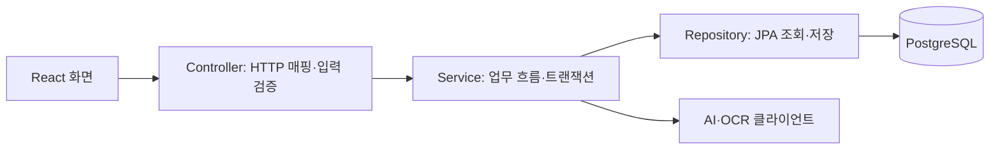
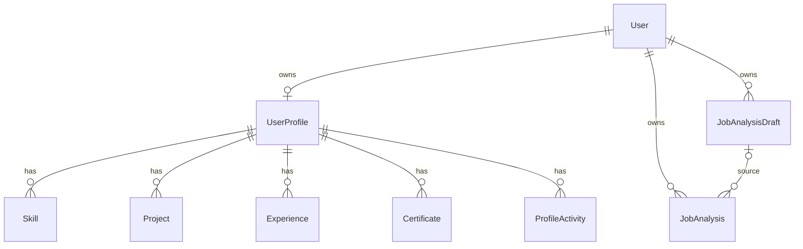

# OnFit Spring 백엔드 읽기 가이드

현재 코드 기준: Java 21, Spring Boot 4.1.1, Spring Web MVC, Spring Data JPA, Spring Security OAuth2 Resource Server, PostgreSQL, Flyway. 의존성은 [`backend/build.gradle`](../backend/build.gradle)에 있다.

## 먼저 읽을 문서

| 문서 | 내용 |
| --- | --- |
| [`docs/README.md`](README.md) | 서비스 전체 구조, 실행, 주요 API |
| [`backend/README.md`](../backend/README.md) | 백엔드 실행·검증, 분석 파이프라인 |
| [`frontend/README.md`](../frontend/README.md) | 프런트 실행, Docker와 개발 서버 차이, 로그인 |
| [`career-evaluation-prompts-v2.md`](career-evaluation-prompts-v2.md) | 향후 평가 프롬프트 설계. 현재 점수 계산에 연결되지는 않음 |
| [`application.yaml`](../backend/src/main/resources/application.yaml) | DB, OCR, AI, 보존 기간 등 런타임 설정 |
| [`db/migration/`](../backend/src/main/resources/db/migration/) | Flyway의 DB 스키마 변경 이력 (`V1`~`V17`) |

## 패키지와 요청 흐름

| 패키지 | 대표 파일 | 책임 |
| --- | --- | --- |
| `profile` | [`ProfileController`](../backend/src/main/java/com/donggeon/jobrecommendation/profile/ProfileController.java), [`ProfileService`](../backend/src/main/java/com/donggeon/jobrecommendation/profile/ProfileService.java) | 내 프로필 생성·조회·수정 |
| `jobanalysis` | [`JobAnalysisController`](../backend/src/main/java/com/donggeon/jobrecommendation/jobanalysis/JobAnalysisController.java), [`JobAnalysisService`](../backend/src/main/java/com/donggeon/jobrecommendation/jobanalysis/JobAnalysisService.java) | 공고 추출, 분석, 결과 조회·재시도 |
| `domain` | [`UserProfile`](../backend/src/main/java/com/donggeon/jobrecommendation/domain/UserProfile.java), [`JobAnalysis`](../backend/src/main/java/com/donggeon/jobrecommendation/domain/JobAnalysis.java) | DB 테이블과 관계를 나타내는 JPA 엔티티 |
| `extraction` | `JobTextExtractionService`, `JobUrlExtractionService` | PDF·이미지·URL 텍스트 추출 |
| `recommendation` | `RecommendationCalculator` 등 | 기술 매칭과 점수 계산을 지원하는 기존 규칙 코드 |
| `config` | [`SecurityConfig`](../backend/src/main/java/com/donggeon/jobrecommendation/config/SecurityConfig.java), [`ApiExceptionHandler`](../backend/src/main/java/com/donggeon/jobrecommendation/config/ApiExceptionHandler.java) | 인증, 오류 응답, 스케줄, 요청 로그 |

프로필 저장 예: `POST /api/profiles` → `ProfileController.create()` → `ProfileService.create()` → `UserProfileRepository.saveAndFlush()` → `user_profiles` 및 하위 테이블.

공고 분석 예: `POST /api/job-analysis/text` → 확인된 원문과 프로필 스냅샷 준비 → AI 공고 구조화 → 백엔드 `JobMatchScorer`/`RubricScorer` 계산 → AI 직무 설명 → 분석 결과 저장. AI 호출 동안 DB 트랜잭션을 열어두지 않으려고 `JobAnalysisService`는 `TransactionTemplate`을 사용한다. 설명 생성이 실패해도 계산된 점수는 저장되고 설명만 재시도할 수 있다.

## HTTP 매핑: 클래스 경로 + 메서드 경로

`@RequestMapping`은 컨트롤러의 공통 경로, `@GetMapping`·`@PostMapping`·`@PutMapping`은 HTTP 메서드와 세부 경로다. 둘을 합쳐 실제 URL이 된다.

| HTTP | 실제 경로 | 메서드 | 입력·응답 |
| --- | --- | --- | --- |
| `POST` | `/api/profiles` | `ProfileController.create` | JSON `ProfileRequest` → 201, `ProfileResponse` |
| `GET` | `/api/profiles/me` | `ProfileController.getMine` | 현재 사용자 프로필 |
| `PUT` | `/api/profiles/me` | `ProfileController.updateMine` | JSON `ProfileRequest` → 갱신 결과 |
| `POST` | `/api/job-analysis/file` | `JobAnalysisController.extract` | `multipart/form-data`의 `file` → 검토할 텍스트 초안 |
| `POST` | `/api/job-analysis/url` | `JobAnalysisController.extractUrl` | JSON URL → 진행 이벤트와 초안을 NDJSON으로 전송 |
| `POST` | `/api/job-analysis/text` | `JobAnalysisController.analyze` | JSON `JobAnalysisRequest` → 점수·설명 |
| `GET` | `/api/job-analysis/{analysisId}` | `JobAnalysisController.get` | 경로의 숫자 ID → 본인 결과 |
| `POST` | `/api/job-analysis/{analysisId}/role-analysis` | `JobAnalysisController.retryRoleAnalysis` | 실패한 AI 직무 설명 재시도 |

예를 들어 `@RequestMapping("/api/job-analysis")`가 붙은 클래스의 `@GetMapping("/{analysisId}")`는 `GET /api/job-analysis/123`이 된다. `@PathVariable Long analysisId`에 `123`이 들어온다.

## 이 프로젝트에서 쓰는 주요 어노테이션

### Spring 빈·설정

| 어노테이션 | 코드에서 하는 일 | 예시 |
| --- | --- | --- |
| `@SpringBootApplication` | 자동 설정과 컴포넌트 검색을 시작 | [`JobRecommendationBackendApplication`](../backend/src/main/java/com/donggeon/jobrecommendation/JobRecommendationBackendApplication.java) |
| `@RestController` | 반환값을 HTTP 응답 본문으로 직렬화 | `ProfileController`, `JobAnalysisController` |
| `@Service` | 업무 로직을 Spring 빈으로 등록 | `ProfileService`, `JobAnalysisService` |
| `@Component` | 일반 기능 빈으로 등록 | `JobAiClient`, `JobMatchScorer`, `CurrentUser` |
| `@Configuration` / `@Bean` | 설정 클래스와 직접 생성하는 빈 | `SecurityConfig`의 `SecurityFilterChain` |
| `@Value("${...}")` | `application.yaml` 또는 환경 변수의 설정값 주입 | `JobAiClient`의 URL·토큰·타임아웃 |
| `@Profile` | 활성 프로필에 따라 빈 선택 | `SecurityConfig`의 테스트·운영 보안 필터 |
| `@ConditionalOnProperty` | 설정값에 따라 설정 클래스 활성화 | `RetentionSchedule`의 정리 작업 |
| `@EnableScheduling` / `@Scheduled` | 주기 작업 활성화·실행 | 매일 만료 데이터 정리 |

컨트롤러와 서비스는 필드에 `@Autowired`를 붙이는 대신 **생성자 매개변수**로 의존성을 받는다. 생성자가 하나면 Spring이 자동 주입한다.

### 요청·검증

| 어노테이션 | 의미 | 이 프로젝트의 예 |
| --- | --- | --- |
| `@RequestBody` | JSON 본문을 Java 객체로 변환 | `@RequestBody ProfileRequest request` |
| `@Valid` | 변환한 DTO의 Jakarta Validation 실행 | `@Valid @RequestBody JobAnalysisRequest` |
| `@RequestParam` | 쿼리·폼·멀티파트 값 받기 | `@RequestParam("file") MultipartFile file` |
| `@PathVariable` | URL 경로 변수 받기 | `@PathVariable Long analysisId` |
| `@NotBlank` / `@NotNull` / `@NotEmpty` | 공백 문자열·null·빈 목록 제한 | [`ProfileRequest`](../backend/src/main/java/com/donggeon/jobrecommendation/profile/ProfileRequest.java) |
| `@Size` / `@Pattern` | 길이·정규식 제한 | `targetRole` 120자, SHA-256 해시 64자리 |

`ProfileRequest`와 `JobAnalysisRequest`는 Java `record`다. 예를 들어 `request.targetRole()`처럼 필드를 읽는다. `List<@NotBlank String>`은 **목록 원소까지** 검사하고, `List<@Valid ProjectInput>`은 내부 DTO까지 검사한다. 입력 검증 실패는 [`ApiExceptionHandler`](../backend/src/main/java/com/donggeon/jobrecommendation/config/ApiExceptionHandler.java)에서 사용자용 `ProblemDetail`로 바꾼다.

### 트랜잭션·JPA 매핑

| 어노테이션 | 의미 | 실제 사용 |
| --- | --- | --- |
| `@Transactional` | 메서드 작업을 한 DB 트랜잭션으로 묶음 | `ProfileService.create/updateMine` |
| `@Transactional(readOnly = true)` | 조회 중심 트랜잭션 | `ProfileService.getMine` |
| `@Entity` / `@Table` | 클래스를 DB 테이블에 매핑 | `UserProfile` → `user_profiles` |
| `@Id` / `@GeneratedValue(IDENTITY)` | 기본키와 DB의 자동 증가 ID | 대부분의 엔티티 |
| `@Column` | 열 이름·길이·null·unique 등 지정 | `JobAnalysis.source_text`는 `text` 열 |
| `@OneToOne` / `@ManyToOne` / `@OneToMany` | 엔티티 관계 | `User` ↔ `UserProfile`, `UserProfile` → `Skill` 등 |
| `@JoinColumn` | 외래 키 열 지정 | `user_profiles.user_id`, `job_analyses.user_id` |
| `@ElementCollection` / `@CollectionTable` | 문자열 같은 값 목록을 별도 테이블에 저장 | 희망 직무·희망 지역 |
| `@Enumerated(EnumType.STRING)` | enum을 이름 문자열로 저장 | 분석 입력 방식 `TEXT`·`FILE`·`URL` |
| `@CreationTimestamp` / `@UpdateTimestamp` | 생성·수정 시간 자동 설정 | `UserProfile`, `JobAnalysis` |
| `@OrderColumn` / `@OrderBy` | 값 목록의 순서 열 / 조회 정렬 | 희망 직무 순서 / 스킬 ID 순서 |

`UserProfile.skills`의 `mappedBy = "profile"`은 하위 `Skill.profile`이 관계의 외래 키를 가진다는 뜻이다. `cascade = ALL`은 프로필 저장·삭제 작업을 자식에 전파하고, `orphanRemoval = true`는 목록에서 제거한 자식을 DB에서도 삭제한다. `FetchType.LAZY`는 연관 엔티티를 처음부터 모두 가져오지 않는 설정이다. 필요한 값은 트랜잭션 안에서 읽거나 스냅샷으로 만든다.

### Repository·예외 처리

`UserProfileRepository extends JpaRepository<UserProfile, Long>`은 기본 `save`, `findById` 등을 제공한다. `findByUserEmail(...)`처럼 메서드 이름을 쿼리로 해석하는 **derived query**도 쓴다. [`JobAnalysisRepository`](../backend/src/main/java/com/donggeon/jobrecommendation/jobanalysis/JobAnalysisRepository.java)의 `findByIdAndUserEmailAndCreatedAtGreaterThanEqual(...)`은 **ID + 소유자 + 보존 기간**을 함께 검사한다. 만료 데이터 삭제는 `@Modifying @Query(nativeQuery = true)`와 `@Param`을 쓴다.

`@RestControllerAdvice`는 여러 컨트롤러의 오류를 한곳에서 처리한다. `@ExceptionHandler`는 특정 예외를 받아 응답으로 변환한다. 이 프로젝트는 `ProblemDetail`에 안전한 안내 문구와 요청 ID를 넣고, 예상치 못한 예외의 원문이나 제출 자료는 응답·로그에 내보내지 않는다.

## 보안과 DB 설정에서 헷갈리기 쉬운 점

- [`SecurityConfig`](../backend/src/main/java/com/donggeon/jobrecommendation/config/SecurityConfig.java)는 운영 경로에서 `/api/**`에 JWT 인증을 요구하고 `/actuator/health`만 공개한다. 테스트 프로필에는 별도의 허용 필터가 있다.
- [`CurrentUser`](../backend/src/main/java/com/donggeon/jobrecommendation/profile/CurrentUser.java)는 운영(`prod`)에서 JWT의 issuer와 subject로 소유자 키를 만든다. 비운영 프로필은 데모 식별자를 사용한다. 보안 필터의 인증 요구와 데이터 소유자 식별은 서로 다른 코드다.
- `application.yaml`의 `spring.jpa.hibernate.ddl-auto: validate`는 기존 테이블을 **검증**한다. 스키마 생성·변경은 Flyway `V...sql` 마이그레이션이 담당한다. 이미 적용된 마이그레이션을 고치기보다 새 버전 파일을 추가한다.
- `spring.jpa.open-in-view: false`이므로 컨트롤러에서 지연 로딩 관계를 읽으려 하지 않는다. 서비스 트랜잭션 안에서 필요한 값을 준비한다.
- 프런트에서 보이는 분석 점수는 `RubricScorer`가 계산한다. AI는 공고 구조화와 근거 설명을 담당한다. 새 [`평가 프롬프트 v2`](career-evaluation-prompts-v2.md)는 아직 실제 점수 계산에 연결되지 않았다.
